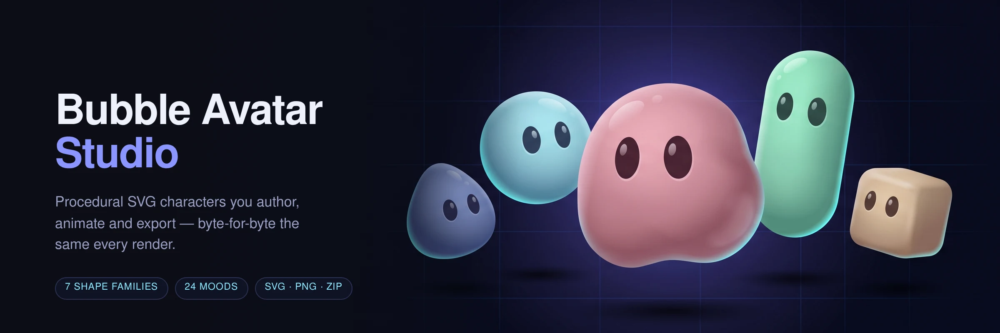
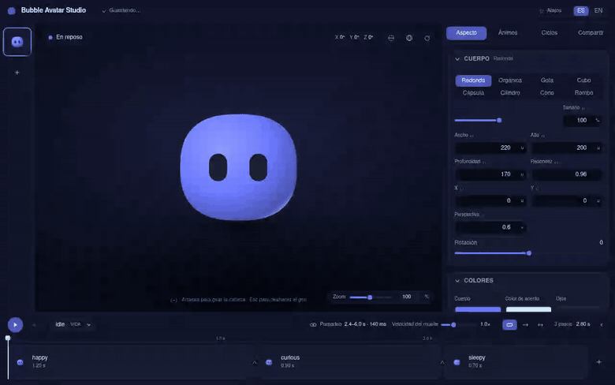

<p align="center">
  
</p>

# Bubble Avatar Studio

Procedural SVG avatar authoring studio by helpbubble. Original clean-room work —
see `docs/CLEANROOM.md` before contributing.

## The studio, running

A real capture of the app: playing a loop, swapping shape families and scaling
the body, previewing moods from the library, posing a mood and aiming its eyes,
turning the character by hand under the wireframe, and framing the export on
the stage it crops.



> The banner is generated art. Everything in the recording above is the actual
> application — `docs/media/demo.mp4` is the same take at full resolution, and
> `docs/screenshots/` holds the eleven frames `pnpm e2e` archives.

## Docs

- `docs/01..08` — product overview, functional spec, data model, architecture,
  UI design, export formats, testing strategy, roadmap.
- `docs/research/` — provenance notes.
- `docs/media/` — README banner and the walkthrough capture.

## Commands

```bash
pnpm install
pnpm dev        # studio at http://localhost:5173
pnpm check      # format + typecheck + lint + tests + build (required gate, also in CI)
pnpm e2e        # Playwright visual smoke against the preview build
```

`make help` lists the same targets if you prefer make; it delegates to these
scripts, which stay the single source of truth.

Screenshots of the eleven smoke scenarios are archived under `docs/screenshots/`
by `pnpm e2e`. They are artifacts for a human to read against
`docs/05-ui-design.md`, not goldens — the stage animates, so pixels differ
between runs.

## Status

**v0.2.0, plus F8.** Every roadmap phase is closed — the track redesign, the
mood pose and a two-defect pass over the v0.1.0 that closed F5. See
`docs/08-roadmap.md` for the phases and `docs/02-functional-spec.md` for the
requirements each one closes. Current gate: **656 tests across 36 files**, plus
a Playwright smoke of 11 scenarios, on a 349.58 kB / 38.60 kB production bundle
— re-derive with `pnpm test` and `pnpm build` rather than trusting this line.

Landed so far: the pure domain, render, export and runtime layers; a studio
shell reaching the whole body model; a projected face that gives the character
volume; idle behaviour (blink, micro-saccades, breathing) so a resting bubble
looks alive; seven shape families on a document that migrates every earlier
version forward; and the starter library — 24 moods across six expressive bands
and 20 loops split life/reaction, meeting FR-4.7 and FR-5.7, which F5 taught to
reach saved projects too and not only new ones.

**The body is a solid.** Each family's flat outline is the generatrix of a
solid of revolution, turned and read back as a silhouette per screen angle, so
a lumpy character shows different lumps as it turns rather than squashing a
sticker. Depth is authored, the guide is a wireframe, the face clips at the
limb, and the character stands on a contact shadow. The round family keeps its
closed form, which is why the goldens never went through the sampler.

**F6 gave playback a track.** The transport left the stage for a permanent
full-width band under all three columns, and took the sequence with it: a step
is a chip as wide as its hold, the ruler is in seconds, and a transition is
edited on the seam it happens on. The playhead is written by hand from a clock
subscription, because FR-11.2 keeps the per-frame path out of the React tree.
The panels reorganised around it — a searchable, usage-badged mood grid, an
offset edited as a place on an XY pad, and a Share panel that draws the export
frame on the stage where framing is decided.

**F7 made a mood turn the body.** A mood carries a three-axis pose of the whole
character (FR-4.10, schema v6), it composes with direct manipulation rather
than replacing it, and travel between two poses takes the shorter arc per axis.
All 24 starter moods are posed, deliberately small. The migration is a no-op by
construction, so no saved character changed and the goldens are byte-identical.

**F8 closed two defects that tests had never been pointed at.** `springSpeed`
was authored, validated, exported and read by the player, and changed nothing:
the speed divided the same duration it multiplied, so every value in the legal
range returned one curve. It is a curve knob now — higher speed arrives sooner
and rings more, the transition window untouched, so the loop summary and the
track's step widths stay out of its reach, and FR-5.4's wording was corrected
to match. And the mood editor's linked mode mirrored each edit onto the other
eye, which is the resting face's handedness rule applied to deltas that aim a
gaze: it put the two pad dots in opposite corners and made a linked mood
impossible to point. Linked copies now, with a **Separación** slider that moves
the pair apart or together about its own midpoint; the one-shot mirror action
stays.

Separately, `docs/research/3d-bubble-exploration.md` records the investigation
behind the solid, including three rendering defects around a full turn — the
shading gradient walking off the character past ~140° of yaw, extras that did
not participate in the projection, and no contact shadow — all three now
closed. The larger idea it prototypes, a silhouette derived from a radius field
over the sphere, still needs a decision before it can be scheduled.

## Architecture

- `src/domain/` — pure domain: document types, validation, mutations with
  copy-on-write kits, geometry (superellipse and organic outlines, the solids
  of revolution they generate, ellipsoid face projection), easing, LoopPlayer,
  blink, ambient idle motion, and `content/` — the starter library as literal
  data.
- `src/render/` — deterministic scene composition + byte-stable SVG output,
  including colour maths for body shading (golden-tested in `src/render/goldens/`).
- `src/app/` — studio shell: rail/stage/inspector, panels, rAF StageEngine,
  reducer store, localStorage autosave, i18n es/en.
- `src/export/` — portable `*.bubble-avatar.json`, SVG/PNG snapshots, ZIP package.
- `src/runtime/` — SSR-safe `<BubbleAvatar/>` React runtime.

`docs/04-architecture.md` §8 carries the full module map.

## Law

1. TDD: no production code without a failing test first (`docs/07`).
   A regression test seen only passing is not evidence — confirm it fails
   against the unfixed code.
2. `src/domain` and `src/render` stay pure TypeScript (lint-enforced).
3. Never read upstream source code (see `docs/CLEANROOM.md` §3). Behavioural
   observation of the deployed app is allowed and logged in
   `docs/research/blackbox-notes.md`; feature parity means matching
   capabilities, never copying names, artwork or UI copy.
4. Goldens change only in a diff that states which values moved and why.
